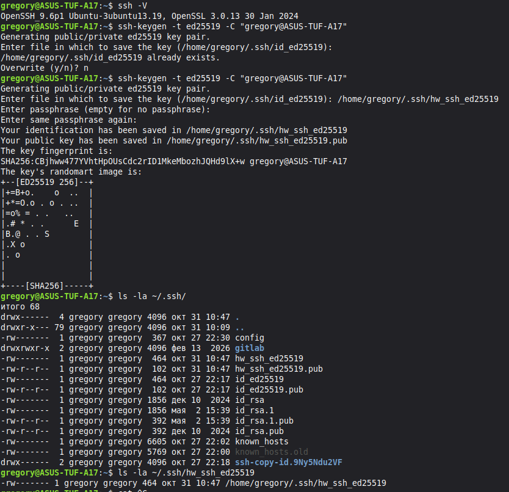
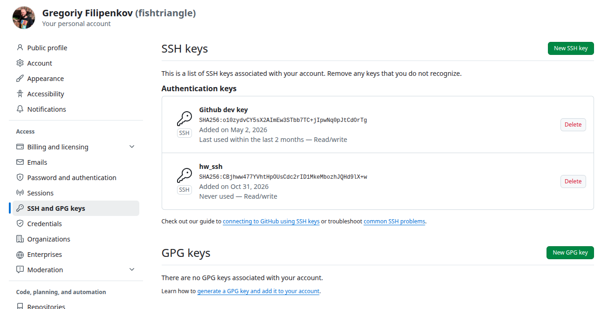
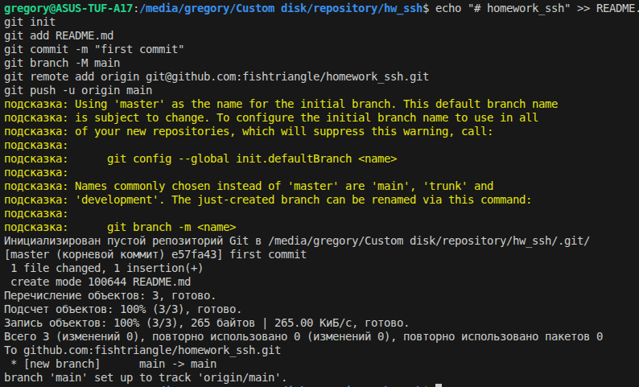

# homework_ssh

## Шаг 1. Установка SSH-клиента и генерация ключевой пары

Проверить наличие SSH-клиента в системе:
```bash
gregory@ASUS-TUF-A17:~$ ssh -V
OpenSSH_9.6p1 Ubuntu-3ubuntu13.19, OpenSSL 3.0.13 30 Jan 2024
```

Сгенерировать новую пару ключей:
```bash
gregory@ASUS-TUF-A17:~$ ssh-keygen -t ed25519 -C "gregory@ASUS-TUF-A17"
Generating public/private ed25519 key pair.
Enter file in which to save the key (/home/gregory/.ssh/id_ed25519): /home/gregory/.ssh/hw_ssh_ed25519 
Enter passphrase (empty for no passphrase): 
Enter same passphrase again: 
Your identification has been saved in /home/gregory/.ssh/hw_ssh_ed25519
Your public key has been saved in /home/gregory/.ssh/hw_ssh_ed25519.pub
The key fingerprint is:
SHA256:CBjhww477YVhtHpOUsCdc2rID1MkeMbozhJQHd9lX+w gregory@ASUS-TUF-A17
The key's randomart image is:
+--[ED25519 256]--+
|+=B+o.    o  ..  |
|+*=O.o . o . ..  |
|=o% = . .   ..   |
|.# * . .      E  |
|B.@ . . S        |
|.X o             |
|. o              |
|                 |
|                 |
+----[SHA256]-----+
```
Проверить что публичный ключ сохранён в ~/.ssh/:
```bash
gregory@ASUS-TUF-A17:~$ ls -la ~/.ssh/hw_ssh_ed25519
-rw------- 1 gregory gregory 464 окт 31 10:47 /home/gregory/.ssh/hw_ssh_ed25519
```



---

## Шаг 2. Добавление публичного ключа в аккаунт GitHub

Скопировать содержимое `~/.ssh/hw_ssh_ed25519.pub` и добавить его в настройках GitHub:

```bash
gregory@ASUS-TUF-A17:~$ cat /home/gregory/.ssh/hw_ssh_ed25519.pub
ssh-ed25519 ********** gregory@ASUS-TUF-A17
```



---

## Шаг 3. Проверка SSH-подключения к GitHub

Убедиться, что соединение с GitHub устанавливается без пароля и возвращается приветствие от GitHub.

```bash
gregory@ASUS-TUF-A17:~$ ssh -T -i ~/.ssh/hw_ssh_ed25519 git@github.com
Hi fishtriangle! You've successfully authenticated, but GitHub does not provide shell access.
```


---

## Шаг 4. Работа с репозиторием по SSH

Клонировать репозиторий по SSH-URL, создать коммит и выполнить `git push` — убедиться, что операция проходит без ввода пароля (используется ключ).

```bash
# Клонирование репозитория по SSH
git clone git@github.com:fishtriangle/homework_ssh.git
cd homework_ssh

# Создание коммита и пуш
git add .
git commit -m "Initial commit: SSH homework"
git push
```



